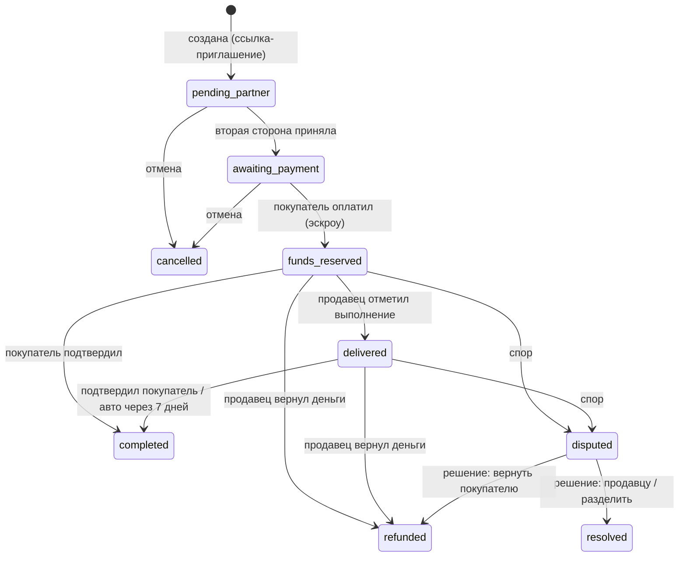

# SafeDeal — архитектура и технологии

Сервис безопасных сделок (эскроу): покупатель платит, деньги резервируются на платформе и
уходят продавцу только после того, как покупатель подтвердил выполнение условий. Если что-то
пошло не так, любая из сторон открывает спор, и решение принимает администрация.

Документ описывает **MVP из этой папки** и **целевую production-архитектуру**, к которой MVP
переходит без переписывания доменной логики.

---

## 1. Стек технологий

### 1.1 MVP (реализовано)

| Слой | Технология | Почему |
|---|---|---|
| Клиент | **React 19 + Vite 8**, React Router 7, чистый CSS | Mobile-first SPA по макету Figma (iOS-экраны: Home, History, Support, Profile, Verification). Без UI-фреймворков: меньше зависимостей, меньше поверхность атаки. |
| Сервер | **Node.js 22 + Express 5** (ESM) | Простота, зрелая экосистема безопасности; Express 5 сам перехватывает ошибки async-обработчиков. |
| БД | **SQLite** (встроенный `node:sqlite`, режим WAL) | Не нужна установка сервера БД. Схема написана на переносимом SQL, переезд на PostgreSQL сводится к замене драйвера. |
| Валидация | **Zod 4** (строгие схемы) | Все входные данные проверяются по схеме, лишние поля отклоняются. |
| Пароли | **Argon2id** (`@node-rs/argon2`) | Рекомендация OWASP; устойчив к перебору на GPU. Параметры: m=19 MiB, t=2, p=1. |
| HTTP-заголовки | **Helmet 8** | CSP, HSTS, frame-ancestors, nosniff, referrer-policy, CORP. |
| Rate limiting | **express-rate-limit 8** | Защита от перебора и злоупотреблений. |
| Шифрование | **Node `crypto`**: AES-256-GCM + HKDF-SHA256 | Персональные данные и файлы шифруются на уровне приложения. |
| Платежи | **Мок PSP** (`server/psp.js`) | Повторяет интерфейс эквайринга: токенизация карты, списание, выплата, отказ. |
| Тесты | `node:test` + Playwright (e2e-проверка вручную) | Интеграционные тесты API покрывают денежные сценарии и безопасность. |

Рантайм-зависимостей всего 5: `express`, `helmet`, `express-rate-limit`, `zod`, `@node-rs/argon2`.
`npm audit` — 0 уязвимостей.

### 1.2 Production (целевая)

| Слой | Технология |
|---|---|
| Мобильные приложения | **React Native (Expo)** + TypeScript. Компоненты и API-клиент переносятся из веб-версии. Токен хранится в Keychain / Keystore, SSL pinning, обнаружение root/jailbreak. |
| Веб | Тот же React-клиент (PWA) |
| API | Node.js + TypeScript (Express или NestJS), горизонтальное масштабирование за балансировщиком |
| БД | **PostgreSQL 16**: `SERIALIZABLE`-транзакции для денежных операций, row-level security, pgaudit |
| Кэш / очереди | **Redis** (сессии, rate limit между инстансами), **BullMQ** (авто-подтверждение сделок, уведомления, вебхуки PSP) |
| Файлы | S3-совместимое хранилище (SSE-KMS), антивирусная проверка (ClamAV) до того, как файл станет доступен |
| Секреты и ключи | **HashiCorp Vault / AWS KMS**: envelope encryption, ротация ключей |
| Платежи | Эквайринг с hosted fields и 3-D Secure (PAN не попадает на наш сервер → минимальная зона PCI DSS SAQ-A). Для КР: банки-эквайеры, Элкарт, MBank/O!Деньги; для РФ: ЮKassa/CloudPayments. Номинальный счёт для хранения средств эскроу. |
| KYC | Sumsub / Veriff: проверка документа, liveness, AML/PEP-скрининг |
| 2FA | TOTP и WebAuthn/passkeys; подтверждение денежных операций (step-up auth) |
| Наблюдаемость | OpenTelemetry, Sentry, Grafana/Loki, алерты на аномалии в леджере |
| Инфраструктура | Docker, Kubernetes, WAF (Cloudflare), TLS 1.3, бэкапы с PITR |
| CI/CD | GitHub Actions: тесты, `npm audit`, Semgrep (SAST), Gitleaks, OWASP ZAP (DAST), Dependabot |

### 1.3 Комментарий по выбору средств безопасности

В сообщении со скриншотом Figma самого списка технологий безопасности не было, поэтому набор
подобран самостоятельно. Главные решения и их причины:

* **Серверные сессии вместо JWT.** Opaque-токен в HttpOnly-cookie, в БД хранится только его
  SHA-256. Сессию можно мгновенно отозвать (выход со всех устройств, смена пароля, блокировка).
  Для финансового сервиса это важнее, чем stateless-JWT, который нельзя отозвать до истечения срока.
* **Argon2id, а не bcrypt.** Современный стандарт и рекомендация OWASP.
* **Мы не храним номер карты.** Хранить PAN = полный аудит PCI DSS. Храним только токен PSP,
  последние 4 цифры и бренд.
* **Двойная запись (double-entry) в журнале проводок** вместо поля `balance` в таблице пользователей.
  Баланс вычисляется из проводок, каждая транзакция в сумме даёт ноль, и это проверяется автоматически.
* **Идемпотентность платежей.** Двойной клик или повтор запроса после сбоя сети не спишет деньги дважды.
* **Журнал аудита с хеш-цепочкой.** Незаметно изменить историю нельзя: правка любой записи
  ломает все следующие хеши.

---

## 2. Архитектура MVP

```
┌──────────────────────────── Браузер / мобильный WebView ─────────────────────────────┐
│ React SPA (client/)                                                                  │
│  pages: Home · History · Support · Profile · Verify(KYC) · NewDeal · Deal · Invite   │
│         Wallet · Security · Notifications · Admin                                    │
│  api.js: cookie-сессия + X-CSRF-Token + X-Requested-With + Idempotency-Key           │
└───────────────────────────────┬──────────────────────────────────────────────────────┘
                                │ HTTPS (в prod), JSON / application/octet-stream
┌───────────────────────────────▼──────────────────────────────────────────────────────┐
│ Express 5 (server/app.js)                                                            │
│  helmet(CSP, HSTS…) → rate-limit → json(64kb) → session → CSRF/Origin → routes       │
│                                                                                      │
│  routes/auth   регистрация, вход, сессии, смена пароля                               │
│  routes/kyc    верификация личности, привязка карты (токенизация)                    │
│  routes/deals  сделки: state machine, эскроу, споры, отзывы, чат, приглашения        │
│  routes/files  загрузка/выдача файлов (проверка сигнатур, шифрование, ACL)           │
│  routes/misc   профили, уведомления, кошелёк/вывод, чат поддержки                    │
│  routes/admin  споры, KYC-заявки, поддержка, аудит, контроль целостности             │
│                                                                                      │
│  ledger.js  двойная запись      audit.js  хеш-цепочка     crypto.js  AES-GCM/HKDF    │
│  psp.js     мок эквайринга      runSweep  авто-подтверждение, очистка сессий         │
└───────────────┬─────────────────────────────────────────┬────────────────────────────┘
                │                                         │
        data/safedeal.db (SQLite WAL)            data/uploads/* (AES-256-GCM)
```

### Структура папки

```
safedeal/
├── ARCHITECTURE.md        этот документ
├── README.md              запуск и демо
├── package.json
├── vite.config.js
├── server/
│   ├── index.js           точка входа
│   ├── app.js             сборка Express, middleware, фоновые задачи
│   ├── config.js          настройки, мастер-ключ
│   ├── db.js              схема БД, транзакции
│   ├── crypto.js          AES-256-GCM, HKDF, токены
│   ├── auth.js            сессии, CSRF, роли
│   ├── audit.js           журнал аудита с хеш-цепочкой
│   ├── ledger.js          двойная запись, инварианты
│   ├── psp.js             мок платёжного провайдера
│   ├── services.js        уведомления, комиссии, рейтинги
│   ├── http.js            ошибки, валидация
│   ├── seed.js            демо-данные
│   └── routes/            auth, kyc, deals, files, misc, admin
├── client/
│   ├── index.html
│   └── src/  App.jsx · api.js · ui.jsx · styles.css · components/Chat.jsx · pages/*
├── tests/api.test.js      интеграционные тесты
└── data/                  (создаётся при запуске, в .gitignore) БД, файлы, ключ
```

---

## 3. Жизненный цикл сделки



* Разрешённые действия вычисляет сервер (`allowedActions`) и отдаёт клиенту, поэтому UI и API не расходятся.
* Каждый переход выполняется так: `UPDATE … WHERE id=? AND status IN (<ожидаемые>)` внутри `BEGIN IMMEDIATE`.
  Гонки (двойное подтверждение, подтверждение одновременно со спором) невозможны, проигравший запрос получает 409.
* Ссылка-приглашение одноразовая: после принятия токен удаляется.
* После отметки «выполнено» покупатель может подтвердить или открыть спор. Если он не ответил
  за 7 дней, средства переводятся автоматически: продавец защищён от покупателя, который пропал.

## 4. Деньги: журнал проводок (double-entry)

Счета: `card:<user>` (внешняя карта), `escrow:<deal>`, `user:<user>` (баланс к выводу), `platform:fees`.

| Операция | Проводки |
|---|---|
| Оплата | `card:buyer −X`, `escrow:deal +X` |
| Подтверждение | `escrow −X`, `user:seller +(сумма − комиссия продавца)`, `platform:fees +комиссия` |
| Возврат | `escrow −X`, `card:buyer +X` |
| Разделение по спору | `escrow −X`, `card:buyer +p%`, `user:seller +(100−p)%` |
| Вывод | `user:seller −Y`, `card:seller +Y` |

* Суммы хранятся целыми числами в центах, без float.
* Таблица `ledger` только для добавления: триггеры запрещают UPDATE и DELETE.
* Инварианты (сумма всех проводок = 0, нет отрицательных эскроу-счетов и балансов) проверяются
  в админ-панели и в тестах.
* Комиссия 2% (минимум $1). Кто её платит (покупатель, продавец или пополам), выбирается при создании сделки.

## 5. Безопасность

### 5.1 Меры защиты

| Угроза (OWASP) | Мера в MVP | Где |
|---|---|---|
| Подбор пароля, credential stuffing | Argon2id; rate limit 20 входов / 15 мин с IP; блокировка аккаунта на 15 мин после 5 ошибок; политика паролей (≥10 символов, буквы и цифры, словарь простых паролей) | `routes/auth.js`, `app.js` |
| Перебор email (user enumeration) | Одинаковый ответ и одинаковое время: verify выполняется по фиктивному хешу, даже если пользователя нет | `routes/auth.js` |
| Кража и фиксация сессии | 256-битный opaque-токен, cookie `HttpOnly; SameSite=Strict; Secure; __Host-`; в БД хранится только SHA-256; новая сессия при каждом входе; таймауты: 12 ч бездействия и 7 дней абсолютный; выход с других устройств; смена пароля завершает остальные сессии | `auth.js` |
| CSRF | SameSite=Strict, проверка `Origin`, synchronizer-токен `X-CSRF-Token`, обязательный `X-Requested-With` (HTML-форма такой заголовок поставить не может) | `auth.js` |
| XSS | React экранирует вывод, нет `dangerouslySetInnerHTML`; строгий CSP без `unsafe-inline` для скриптов; `frame-ancestors 'none'` | `app.js` |
| IDOR / нарушение контроля доступа | Каждая сделка, сообщение и файл проверяются на участие пользователя; для чужих объектов ответ 404 (существование не раскрывается); RBAC для админки | `routes/deals.js`, `routes/files.js` |
| Mass assignment / инъекции | Строгие Zod-схемы (`.strict()`), только prepared statements, лимит тела 64 КБ | `http.js` |
| Двойное списание, гонки | `Idempotency-Key` на оплату и вывод; `BEGIN IMMEDIATE`; условные UPDATE по статусу; версия записи | `routes/deals.js`, `routes/misc.js` |
| Подделка финансовой истории | Журнал проводок и аудит только для добавления (триггеры), хеш-цепочка аудита с проверкой целостности | `db.js`, `audit.js`, `ledger.js` |
| Утечка персональных данных | ФИО и номер паспорта зашифрованы AES-256-GCM (отдельный подключ через HKDF); в интерфейсе паспорт маскируется; каждый просмотр PII администратором пишется в аудит | `crypto.js`, `routes/kyc.js`, `routes/admin.js` |
| Утечка платёжных данных | PAN и CVV не сохраняются и не логируются, хранится только токен PSP и last4; проверка Луна | `psp.js` |
| Вредоносные файлы | Белый список по сигнатурам (PDF/PNG/JPEG/WEBP), лимит 10 МБ, случайные имена на диске, шифрование, проверка SHA-256 при выдаче, `Content-Disposition: attachment`, `nosniff`, sandbox-CSP | `routes/files.js` |
| Open redirect | Параметр `?next` принимает только относительные пути | `client/src/App.jsx` |
| Утечка внутренних ошибок | Клиенту отдаётся общее сообщение, стек-трейс только в серверный лог | `app.js` |
| Clickjacking, sniffing, утечка referrer | `frame-ancestors 'none'`, `X-Content-Type-Options`, `Referrer-Policy: no-referrer`, `Permissions-Policy` | `app.js` |
| Мошенничество между пользователями | Обязательный KYC для оплаты и вывода, рейтинги и отзывы только по реальным завершённым сделкам (одна сделка = один отзыв), споры с доказательствами | `routes/deals.js` |

### 5.2 Что в MVP упрощено (и как закрывается в production)

| Упрощение | В production |
|---|---|
| Мок PSP, PAN проходит через сервер | Hosted fields и 3-D Secure, PAN не касается нашего сервера |
| KYC в dev-режиме одобряется автоматически (`KYC_AUTO_APPROVE`) | KYC-провайдер с liveness; ручная проверка спорных случаев |
| Мастер-ключ в файле `data/.master.key` (в dev) | KMS/Vault, envelope encryption, ротация |
| SQLite, один процесс | PostgreSQL, Redis для сессий и rate limit, несколько инстансов |
| Нет 2FA | TOTP / passkeys + step-up при оплате и выводе |
| Чат по опросу (polling раз в 4 с) | WebSocket/SSE с авторизацией по сессии |
| Нет антивируса для файлов | ClamAV / облачный сканер до публикации файла |
| Нет email/SMS | Уведомления через провайдера, подтверждение email |

## 6. API (кратко)

```
POST /api/auth/register | login | logout | logout-others | password     GET /api/auth/me | sessions
GET|POST /api/kyc          PUT /api/kyc/card
POST /api/files            GET /api/files/:id
GET|POST /api/deals        GET /api/deals/:id
POST /api/deals/:id/{pay|deliver|confirm|refund|cancel|dispute|review}
GET|POST /api/deals/:id/messages
GET /api/invite/:token     POST /api/invite/:token/accept
GET /api/users/:id         GET /api/notifications   POST /api/notifications/read
GET /api/wallet            POST /api/wallet/withdraw
GET|POST /api/support/messages
GET /api/admin/{overview|disputes|kyc|support|audit}
POST /api/admin/deals/:id/resolve   GET|POST /api/admin/kyc/:id   GET|POST /api/admin/support/:userId
```

Все изменяющие запросы требуют заголовки `X-Requested-With: SafeDeal` и `X-CSRF-Token`,
денежные ещё и `Idempotency-Key`.

## 7. Дорожная карта

1. **v0.2**: PostgreSQL, Redis, TypeScript, вебхуки PSP, email-уведомления, 2FA.
2. **v0.3**: мобильные приложения на React Native (Expo), push-уведомления, WebSocket-чат.
3. **v0.4**: интеграции. Кнопка «Купить через SafeDeal» и виджет для объявлений Lalafo/Avito,
   API для интернет-магазинов (OAuth2 + HMAC-подписанные вебхуки), трекинг служб доставки
   (авто-статус «доставлено»).
4. **v1.0**: реальный эквайринг и номинальный счёт, юридическая оферта, AML-мониторинг,
   внешний пентест, bug bounty.
